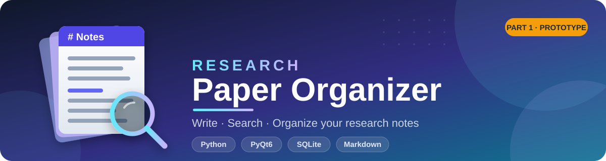

<div align="center">



<br>

**A clean, local-first desktop app for writing, searching, and organizing your research notes.**


<br>


</div>

---

## 📖 About

**Research Paper Organizer** is a Python desktop application for organizing research notes. This repository contains **Part 1 (Progress Prototype)** of an academic software project, covering the core note-taking workflow: write in Markdown, preview it live, and keep everything stored locally.

---

## ✨ Features in Part 1

| | Feature | Description |
|---|---|---|
| 📝 | **Note management** | Create, save, update, and delete research notes |
| 💾 | **Local storage** | Notes are stored on your machine with SQLite |
| 🔍 | **Search** | Find notes by title or content |
| ✍️ | **Markdown editing** | Write notes in Markdown |
| 👁️ | **Live preview** | Preview Markdown formatting inside the desktop app |

---

## 🧰 Tech Stack

| Technology | Purpose |
|---|---|
| **Python 3.10+** | Core language |
| **PyQt6** | Desktop user interface |
| **Qt WebEngine** | Rendering the Markdown preview |
| **SQLite** | Local note database |
| **Python-Markdown** | Markdown to HTML conversion |

---

## 🚀 Getting Started (Windows)

### Run from source

1. **Install Python 3.10 or later** (64-bit recommended).
2. **Clone or download** this repository.
3. **Open the project folder** in VS Code.
4. **Create and activate a virtual environment:**

   ```powershell
   python -m venv .venv
   .\.venv\Scripts\Activate.ps1
   ```

5. **Install dependencies and start the app:**

   ```powershell
   python -m pip install -r requirements.txt
   python app.py
   ```

> 💡 **Tip:** You can also try `run_windows.bat` on Windows.

---

## 📦 Build a Portable Windows App

Build on Windows. From the project folder, run:

```powershell
python -m pip install -r requirements.txt
python -m pip install pyinstaller
python -m PyInstaller --noconfirm --clean --windowed --onedir --name ResearchPaperOrganizer --collect-all PyQt6.QtWebEngineCore --collect-all PyQt6.QtWebEngineWidgets app.py
```

The output will be in `dist/ResearchPaperOrganizer/`.

> ⚠️ Copy the **entire folder**, not only the `.exe`, to another Windows computer. Test the build on your own PC before sharing it.

---

## 🗄️ Data Storage

The app creates a local `research_notes.db` file.

| Run mode | Database location |
|---|---|
| **From source** | Beside `app.py` |
| **Packaged build** | Beside the executable |
| **Fallback** (if that folder isn't writable) | `%LOCALAPPDATA%\ResearchPaperOrganizer` |

> 🔒 Do not commit your personal database file to GitHub. The `.gitignore` excludes SQLite database files and generated build folders.

---

## 🗺️ Roadmap for Part 2

- [ ] 🏷️ Automatic keyword extraction
- [ ] 🖼️ Image insertion in notes
- [ ] 📑 APA-style citation generation and citation metadata management
- [ ] 📤 PDF and DOCX export
- [ ] ✅ Testing, accessibility/UI polish, and project documentation

> LaTeX document generation and BibTeX citation output are not included in this project scope.

---

## 📌 Project Status

This is an **academic project prototype**. The Windows executable has not been included in this repository. Build and test it locally before presenting or distributing it.

---

## 🤝 Connect With Me

<div align="center">

[](https://github.com/mdshihabhossain726)
[](mailto:mdshihabhossain726@gmail.com)
[](https://www.linkedin.com/in/mdshihabhossain726/)
[](https://mdshihabhossain726.github.io/)

<br>

⭐ If you find this project useful, consider giving it a star!

</div>
