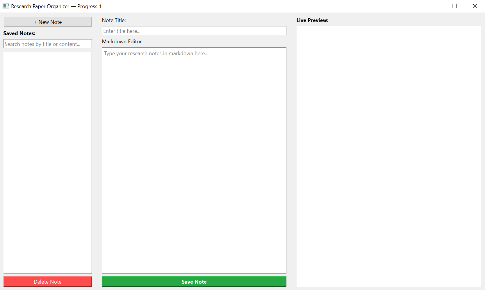

# Research Paper Organizer

A Python desktop application for organizing research notes. This repository contains **Part 1 (Progress Prototype)** of an academic software project.

## Features in Part 1

- Create, save, update, and delete research notes
- Store notes locally with SQLite
- Search notes by title or content
- Write notes in Markdown
- Preview Markdown formatting inside the desktop application

## Tech Stack

- Python 3.10+
- PyQt6
- Qt WebEngine
- SQLite
- Python-Markdown

## Screenshots



## Run from Source (Windows)

1. Install Python 3.10 or later (64-bit recommended).
2. Clone or download this repository.
3. Open the project folder in VS Code.
4. Create and activate a virtual environment:

   ```powershell
   python -m venv .venv
   .\.venv\Scripts\Activate.ps1
   ```

5. Install dependencies and start the application:

   ```powershell
   python -m pip install -r requirements.txt
   python app.py
   ```

You can also try `run_windows.bat` on Windows.

## Build a Portable Windows App

Build on Windows. From the project folder, run:

```powershell
python -m pip install -r requirements.txt
python -m pip install pyinstaller
python -m PyInstaller --noconfirm --clean --windowed --onedir --name ResearchPaperOrganizer --collect-all PyQt6.QtWebEngineCore --collect-all PyQt6.QtWebEngineWidgets app.py
```

The output should be in `dist/ResearchPaperOrganizer/`. Copy the **entire folder**, not only the `.exe`, to another Windows computer. Test the build on your own PC before sharing it.

## Data Storage

The application creates `research_notes.db` locally. When run from source, the database is stored beside `app.py`. In a packaged build, it attempts to use the folder beside the executable; if that folder is not writable, it falls back to `%LOCALAPPDATA%\ResearchPaperOrganizer`.

Do not commit your personal database file to GitHub. The `.gitignore` excludes SQLite database files and generated build folders.

## Roadmap for Part 2

- Automatic keyword extraction
- Image insertion in notes
- APA-style citation generation and citation metadata management
- PDF and DOCX export
- Testing, accessibility/UI polish, and project documentation

LaTeX document generation and BibTeX citation output are not included in this project scope.

## Project Status

This is an academic project prototype. The Windows executable has not been included in this repository. Build and test it locally before presenting or distributing it.

## 🤝 Connect With Me

- GitHub: [@mdshihabhossain726](https://github.com/mdshihabhossain726)
- Email: mdshihabhossain726@gmail.com
- Linkedin: [Md Shihab Hossain](https://www.linkedin.com/in/mdshihabhossain726/).
